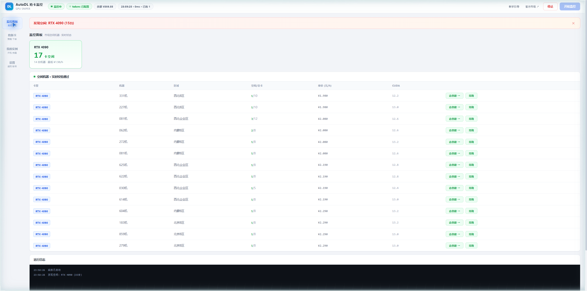

# autodl-sniper

> 🎯 AutoDL 显卡蹲守 & 抢卡工具 —— 别再手动刷新了，空卡一出：响铃、推送、自动下单、克隆换机，一条龙。




AutoDL 的空闲显卡就像食堂最后一份糖醋排骨：犹豫几秒，就没了。这个工具帮你 7×24 盯着市场页背后的接口，空卡一冒头立刻通知你——或者直接帮你拿下。

## ✨ 它能做什么

- 🖥️ **网页控制台**：卡型/区域/空闲数/最高单价自由组合，各卡型空闲数、机器数、最低价一目了然
- 🔍 **幽灵过滤**：市场列表有缓存，显示空闲的机器可能已下线——每台候选都做实时在线校验，表格里只剩真能抢的
- 🔔 **三通道报警**：响铃（可常响）+ 浏览器桌面通知 + Webhook（`{msg}` 占位，Bark/企业微信都能接）；支持"从无到有才报"或"每台新机器都报"
- ⚡ **自动下单**：新建镜像实例，或**把已关机实例克隆到任意兼容机器**（不同卡型、不同区域都行，环境随盘带走）；自动校验 CPU 架构/芯片厂商/CUDA/数据盘
- 💤 **关机续命**：关机实例想开回时宿主机要有空卡——盯住房产，腾出卡就提醒你，甚至可以自动开机
- 🔑 **token 无感续期**：自动从本机浏览器读回登录态，失效后重新登录自动接回；子账号也兼容
- 🧭 **零门槛**：首次连接向导 + 全界面新手引导，不需要会写代码

## 🚀 快速开始

需要 Python 3.8+（**没有任何第三方依赖**）和自己的 AutoDL 账号。

```bash
git clone https://github.com/MSWEIMZ/autodl-sniper.git
cd autodl-sniper
python autodl_monitor.py     # Windows 也可以双击 启动监控.bat
```

浏览器打开 <http://127.0.0.1:8917>，然后：

| 步骤 | 操作 |
| --- | --- |
| 1️⃣ 连账号 | 点"去 AutoDL 登录"登录 → 回来点"⚡ 立即读取浏览器 Token"，自动接回 |
| 2️⃣ 选卡 | "抢新卡"页点选要盯的卡型（可多选），按需选区域 |
| 3️⃣ 开盯 | 顶部"开始监控"，绿灯亮起即可去喝咖啡 |

> 💡 挂机场景推荐用控制台 **设置 → 开发者 Token** 粘贴到设置页，不怕网页登录过期。
> 默认只报警不花钱——`自动下单` 和 `自动开机` 都需要你手动打开。

## 🖥️ 界面说明

| 页面 | 干什么 |
| --- | --- |
| 监控面板 | 空闲概览 · 通过校验的可抢机器（去创建 / 克隆）· 运行日志 |
| 抢新卡 | 盯哪些卡、什么条件触发、触发后做什么（报警 / 开页面 / 自动下单） |
| 我的实例 | 实例与宿主机空卡状态；☑监控 = 可开机提醒；◉克隆源 = 克隆用谁的盘 |
| 设置 | 声音 / Webhook / 报警模式 / 手动粘贴 token |

## ⚙️ 常用配置

界面里改即生效并写入 `config.json`（含 token，已被 gitignore）。完整字段见 `config.example.json`：

| 字段 | 说明 |
| --- | --- |
| `interval` | 轮询秒数，建议 ≥3；触发 429 限流会自动退避 |
| `auto_create` | **自动下单总开关，默认 false** |
| `grab_mode` | `image` 新建 / `clone` 克隆已有实例 |
| `grab_window_enable` | 限定时间段开抢，窗口外只监控 |
| `auto_stop_after_create` | 抢到一台自动收手，防止连抢 |
| `watch_boot` / `auto_power_on` | 关机实例宿主机监控 / 可开机时自动开机 |
| `charge_type` / `prepay_duration` | 按量 / 包日 / 包周 / 包月 |
| `alert_mode` / `alert_cooldown` | 报警触发模式与冷却 |

## 🔐 安全与隐私

- 面板**只监听 127.0.0.1**——不要把端口转发到局域网或公网
- Token 只存本机 `config.json`（明文），接口下发前端时永远脱敏，不上传任何第三方
- "自动导入 token"会**遍历本机浏览器 Local Storage** 找 `autodl.com` 的登录记录并校验有效性——只读本机文件、不上传；实现见 `_scan_leveldb_tokens`，欢迎审计，不想用可以全程手动粘贴
- 接口对跨站请求做了 Origin 白名单，别的网页无法驱动你的本地面板

## ⚠️ 免责声明

- 非官方工具，与 AutoDL 无关联；接口字段来自对官网行为的观察，官网变更可能导致功能失效
- **自动下单 / 克隆 / 自动开机 = 真实扣费**。默认全部关闭，开之前请确认计费方式、镜像、数据盘配置无误
- 请合理设置轮询间隔，遵守 AutoDL 服务条款；使用产生的费用与账号风险自负，仅供学习交流

## ❓ 常见问题

**token 老失效怎么办？**
重新登录 autodl.com 约 15 秒内自动接回；挂机建议改用控制台"开发者 Token"，长期有效。

**日志说"过滤 N 台幽灵空闲"？**
市场列表有缓存，下线的机器还显示空闲；工具逐台在线校验，只留下能真下单的。

**子账号能用吗？**
能，请求自动改写 `sub_user` 路径；没有算力市场权限时会中文提示换号。

**怎么确认没抢到 / 抢到没停？**
顶部横幅绿色=下单成功、红色=失败，日志里有具体原因（余额不足、未实名、被抢先等）；"抢到即停"成功后自动关闭自动下单。

## 🛠️ 技术说明

```
autodl_monitor.py   # 后端：轮询 + AutoDL API 封装 + HTTP 服务（纯标准库）
monitor.html        # 前端：监控面板（原生 JS，无构建无框架）
启动监控.bat        # 一键启动（另有 start.bat / start.sh）
config.example.json # 配置模板
```

- 单进程 `ThreadingHTTPServer`，固定 `127.0.0.1:8917`
- 克隆下单前做兼容性检查（架构 / 芯片厂商 / CUDA 上限 / 数据盘容量）
- 无数据库，全部状态 = 一个 `config.json`

## License

[MIT](LICENSE) · 觉得好用欢迎 ⭐Star，有 bug 或想法欢迎 Issue / PR。
